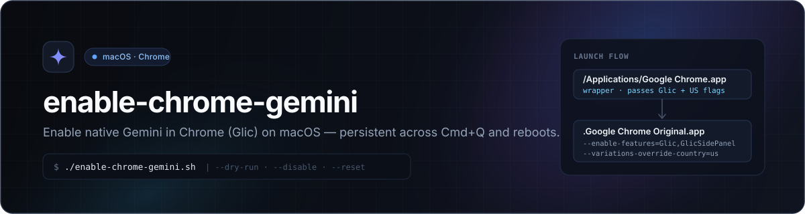

<p align="center">
  
</p>

<p align="center">
  <a href="#install">Install</a> &nbsp;&middot;&nbsp;
  <a href="#options">Options</a> &nbsp;&middot;&nbsp;
  <a href="#how-it-works">How it works</a> &nbsp;&middot;&nbsp;
  <a href="#uninstall">Uninstall</a> &nbsp;&middot;&nbsp;
  <a href="LICENSE">MIT License</a>
</p>

---

## Install

Run directly in Terminal:

```bash
curl -fsSL https://raw.githubusercontent.com/leonsuv/enable-chrome-gemini/main/enable-chrome-gemini.sh | bash
```

Or clone and inspect first:

```bash
git clone https://github.com/leonsuv/enable-chrome-gemini.git
cd enable-chrome-gemini
./enable-chrome-gemini.sh --dry-run
./enable-chrome-gemini.sh
```

## Options

| Flag | Behavior |
| :--- | :--- |
| *(default)* | Writes Chrome AI `defaults`, backs up `Google Chrome.app`, installs the wrapper, and relaunches Chrome. |
| `--dry-run` | Prints every action without modifying apps, `defaults`, or the running Chrome session. |
| `--disable` | Sets `GeminiSettings=1` and `GeminiActOnWebSettings=1`, restores the original `Google Chrome.app`, and relaunches Chrome. |
| `--reset` | Deletes all `com.google.Chrome` keys set by this script, restores the original `Google Chrome.app`, and relaunches Chrome. |
| `-h`, `--help` | Displays usage information. |

## How it works

1. **Sets `com.google.Chrome` preferences** to allow Gemini, agentic web actions, on-device model downloads, and `en-US` UI language.
2. **Backs up Chrome** by moving `/Applications/Google Chrome.app` to `/Applications/.Google Chrome Original.app` (hidden from Finder, Spotlight, and Launchpad).
3. **Installs a transparent wrapper** at `/Applications/Google Chrome.app` (using Chrome's icon and `LSUIElement=true`) that forwards every Dock, Spotlight, or Login Item launch to the backed-up bundle with the Glic and US variations flags.

Re-running the script is idempotent — a marker file inside the wrapper ensures the original backup is never overwritten.

<details>
<summary>Exact defaults and launch flags</summary>

<br>

**macOS `defaults` (`com.google.Chrome`)**

| Key | Value |
| :--- | :--- |
| `GeminiSettings` | `0` |
| `GeminiActOnWebSettings` | `0` |
| `GenAiDefaultSettings` | `0` |
| `GenAILocalFoundationalModelSettings` | `0` |
| `AppleLanguages` | `("en-US")` |

**Launch command inside wrapper**

```bash
open -a "/Applications/.Google Chrome Original.app" --args \
  --enable-features="Glic,GlicSidePanel,GlicUnifiedFreScreen" \
  --variations-override-country="us" \
  "$@"
```

</details>

## Uninstall

Disable Gemini in Chrome and restore the original app bundle:

```bash
./enable-chrome-gemini.sh --disable
```

Or remove all preferences added by this script and restore Chrome to stock:

```bash
./enable-chrome-gemini.sh --reset
```

## Notes

- **Requirements:** macOS with Google Chrome 141+ installed at `/Applications/Google Chrome.app` (tested on Chrome 158) and a personal Google Account (18+) or permitted Workspace account.
- **Updating Chrome:** Run `./enable-chrome-gemini.sh --reset` before applying a Chrome update, then re-run `./enable-chrome-gemini.sh` afterward.
- **Regional availability:** This enables Chrome's client-side Gemini UI. The side panel connects to Google's servers, which enforce server-side regional availability based on IP and account location.
- **Disclaimer:** Uses only documented macOS `defaults` and Chromium launch flags. Subject to Google's Terms of Service and regional rollout.
